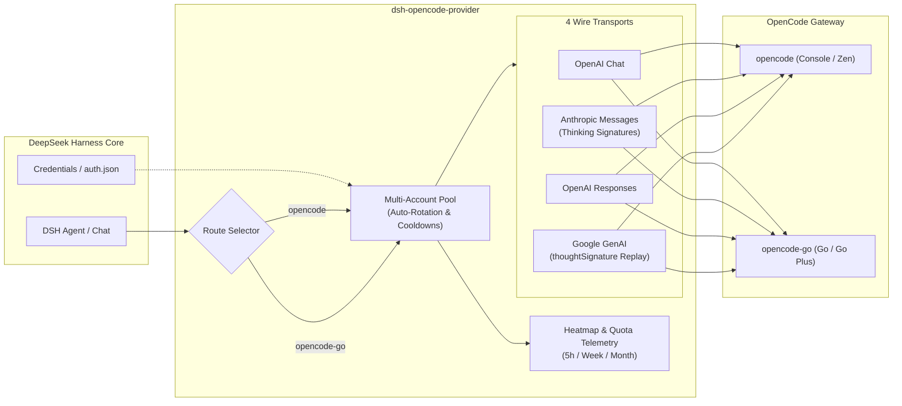
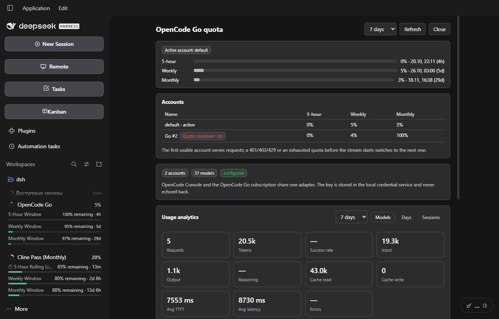

# 📦 @goodandready/dsh-opencode-provider

<div align="center">

<h3>OpenCode Console & OpenCode Go LLM Provider for DeepSeek Harness</h3>

<p>
  <a href="https://goodandready.app/"></a>
  <a href="https://www.npmjs.com/package/@goodandready/dsh-opencode-provider"></a>
  <a href="https://github.com/GooDAnDReaDY/dsh-opencode-provider/blob/main/LICENSE"></a>
</p>

</div>

<table align="center">
  <tr>
    <td align="center">
      ⭐ <strong>If you like this plugin, please star it on GitHub</strong> — it shows me that the plugin is useful to you and motivates me to keep developing it.
      <br><br>
      🐛 <strong>If you find a bug or would like to request a feature</strong>, open a GitHub issue in any language — I will review your proposal and implement useful suggestions in a future plugin version.
    </td>
  </tr>
</table>

---

OpenCode / OpenCode Go provider plugin for [DeepSeek Harness](https://deepseek-harness.github.io/deepseek-harness/) (dsh).

It registers two native LLM routes:

| Route | Product | Base |
|---|---|---|
| `opencode` | OpenCode Console / Zen (pay-as-you-go) | `https://opencode.ai/inference` |
| `opencode-go` | OpenCode Go / Go Plus subscription | `https://opencode.ai/inference/go` |

Requests resolve the key per call, so a changed credential reaches the next request without a restart.

## Architecture



## What works

- **Four wire transports**, chosen per model:
  - OpenAI Chat Completions (DeepSeek, GLM, Kimi, MiMo, LongCat, Hy3, Step, …).
  - Anthropic Messages (Claude Haiku, MiniMax, Qwen).
  - OpenAI Responses (GPT, Grok, Muse).
  - Google Generative AI (Gemini).
- **Text, reasoning, streamed tool calls, usage, finish reasons.**
- **Images** through the durable attachment service, rendered natively per transport; **file attachments** are projected to DSH's deterministic handle text (the harness supplies the read-only execution path), never inline bytes.
- **Tool-result images** are inlined by Anthropic, OpenAI Responses and Google; OpenAI Chat keeps the text placeholder because its tool message has no image part.
- **Replay of provider metadata** where the endpoint requires it:
  - Anthropic thinking signatures.
  - Gemini `thoughtSignature` on historical function calls.
- **Multi-account rotation** before a stream starts: 401/403/429 and quota/usage-limit bodies (400/402/403/429). An invalid key cools down for 24h, a quota rejection for 10 minutes or `Retry-After`, a rate limit for 60s or `Retry-After`. A request already streaming is never replayed on another account; the next request uses the next usable key.
- **Per-account quotas**: each account row shows its own 5-hour / weekly / monthly usage, the active account drives the sidebar and quota panel, and the panel lists every account side by side.
- **Per-account runway**: estimates time to exhaustion from the average burn rate of each window and marks the first window projected to run out before its reset; approximate because the API exposes only the current percentage and reset time.
- **Model → account rules**: first matching glob pins a preferred account for that model; the other accounts remain fallbacks if it fails or is cooling.
- **Request heatmap** in the quota panel: a Monday-first weekday × hour grid in local time, plus a 24-hour aggregate strip underneath. Selectors switch between all requests, any single model, and any single account. The adapter appends `{at, provider, model, purpose?, account, reason}` to `~/.dsh/storages/dsh-opencode/requests.jsonl`; no prompt, response or key is stored. Auxiliary `session-title`/`compaction` calls are excluded from the heatmap and exact duplicate records collapse. The log compacts at 2 MB to the newest 5000 lines. Collection starts with this build — the projection cache only has `lastPromptAt`, not per-request timestamps.
- **Stable `x-opencode-session`** derived from the durable session id, so retries and every turn of a conversation reuse the same routing key.
- **Live catalog** from `/v1/models` with a generated `models.dev` fallback.
- **Per-model subscription limits** from the OpenCode Go pricing table: monthly dollar allowance plus estimated requests for the 5-hour, weekly and monthly windows, for both Go and Go Plus. Shown in the model picker and the settings page; estimates only — the gateway remains the authority.
- **`/opencode` command** for status, usage, accounts, models, rules, and `test [model]`.
- **TUI settings section** for the terminal profile (`/settings → OpenCode`) with the key, endpoints, allowlist, active account, fallback model, sticky routing and timeouts.
- **Quota fallback**: choose a free model in Settings → OpenCode; a Go quota rejection retries once through Console/Zen.
- **Sticky account**: the last successful account is preferred for the same conversation; explicit model rules and pinned accounts win.
- **Routing trace** in the quota panel and per-account heatmap filter.
- **One-click plugin update** in Settings → OpenCode: current/latest version, an update badge, and an **Update now** button that installs the exact npm version through the DSH CLI and asks for a restart. The host endpoint is `GET/POST /dsh-opencode/update`.
- **Plan-aware Go picker**: hides models outside the Go table unless turned off; descriptions carry `Go`, `Console` or `FREE`.
- **Request-wide image budget** (newest images win, oldest become an omitted placeholder) and **object-root tool-schema normalization** for MCP/third-party tools.
- **Usage analytics dashboard** in the quota panel: KPI cards (requests, tokens, success, input/output, reasoning, cache, TTFT, latency, errors), a 7/30/90 selector, and Models / Days / Sessions tables. Success and error cards show `—`: the local projection does not expose failed attempts or reasoning tokens.
- **Usage by model** from the local session projection cache: sessions and tokens per OpenCode model. Only numeric metadata is read; titles and message content stay local.
- **Browser UI**:
  - **Settings → OpenCode**: key status, paste/import/clear, quota bars, accounts, model allowlist, per-model transport overrides, connection settings.
  - **Sidebar quota card** (off by default): a ring with the active account and the highest window, then 5-hour / weekly / monthly rows with remaining quota, reset countdown and bars; clicking opens the full quota panel in the center column. The panel scrolls internally, so the heatmap and usage table below the fold stay reachable.
  - **Cost** is shown only by DSH's native cost display; the plugin does not add a second composer pill.
  - Model price badges in the settings page; the OpenCode auth-entry field autocompletes from `auth.json`.
  - Host routes under `/dsh-opencode/*` serve state and accept writes only from a loopback Host with same-origin and JSON checks; `GET /dsh-opencode/health` reports provider registration, accounts and model count.
  - The provider keeps core harness tools (`read`, `write`, `edit`, `bash`, `glob`, `grep`, …) when a large MCP set is trimmed to OpenCode's 128-tool limit.

## Install

Build and pack first:

```bash
npm install
npm run build
npm pack
```

Install the **packed tarball** into a profile:

```bash
dsh plugin --profile web add /absolute/path/to/goodandready-dsh-opencode-provider-0.5.4.tgz
# DSH Desktop:
dsh plugin --profile desktop add /absolute/path/to/goodandready-dsh-opencode-provider-0.5.4.tgz

# Or install the published package:
dsh plugin --profile web add @goodandready/dsh-opencode-provider@0.5.4
```

Restart dsh (or DSH Desktop), then pick `OpenCode` or `OpenCode Go` in the model picker.

> **Use the tarball, not the directory.** On dsh 0.2.1-rc.2 the Desktop CLI aliases a local
> directory passed to `dsh plugin add` as `@deepseek-ai/dsh-desktop-runtime` and overwrites
> the target's `package.json`. Installing the packed `.tgz` avoids that path and installs
> the package under its real name.

## Verified in DSH Desktop

Tested against DSH Desktop **0.2.1-rc.2**:

- the plugin loads and `/dsh-opencode/state` returns `200`;
- the key is picked up from `~/.local/share/opencode/auth.json`;
- the live catalog returned 37 models with prices and Go limits;
- quota windows returned `rolling / weekly / monthly`;
- `/dsh-opencode/analytics` scanned 7 local sessions (0 OpenCode sessions yet, as expected before the first OpenCode chat);
- `/dsh-opencode/test` against the default flash model returned `{"ok":true,"text":"OK"}`;
- a second Go account was added, the default key was temporarily replaced with an invalid one, and `/test` rotated to the second account and still returned `OK`;
- the second account was already at ~98% of its monthly allowance; the rotation test pushed it over, so a later run surfaced `QUOTA`, marked the default as `invalid-credential` and `Go #2` as `quota` until its reset, with no active account;
- per-account usage returned `default` 1% / 5% / 2% and `Go #2` 9% / 4% / **100%** monthly (`rate-limited`), so the exhausted account is visible without a failed request;
- two `/test` requests produced `Tue 13:00 = 2` in the heatmap and two lines in `requests.jsonl`; the 24-hour strip shows the same value at 13:00;
- a third request with a free-tier model added a second per-model series, so the model selector is populated;
- after restarting Desktop, `Go #2` still showed its persisted `quota` cooldown while the restored default key was active;
- setting `*free* → Go #2` through `/config` returned the normalized rule from `/state`, and clearing it returned `[]`; the account list stayed unchanged;
- the redesigned sidebar card was checked in Desktop: `OpenCode Go` with a 5% ring, `5-Hour Window 99% remaining · 3h`, `Weekly Window 95% remaining · 6d`, `Monthly Window 98% remaining · 29d`; it uses the DSH theme variables and matches the meter's row/ring layout;
- a real chat produced two OpenCode sessions: one standard flash model (4105 in / 243 out, ≈$0.00079) and one free model (10670 in / 171 out, Free); the heatmap counted 6 main requests (the two title calls and exact duplicates are filtered);
- the renderer loaded the client bundle (`settings.opencode` is present in its code cache).

Open **Settings → OpenCode** and enable *Show the quota card in the sidebar* if you want the sidebar meter.

## Configure

```yaml
- id: llm-opencode
  name: "@goodandready/dsh-opencode-provider"
  config:
    apiKeyEnv: OPENCODE_API_KEY   # default
    # apiKey: oc_sk_...           # composition only, never commit
    openCodeAuthEntry: opencode-go
    requestTimeoutMs: 300000
    streamIdleTimeoutMs: 300000
    visibleModels: []
    modelTransports: {}
    # contextWindowOverrides: { model-id: 65536 }
    # maxOutputTokens: 32768
    accounts:
      - label: Go #2
        apiKeyEnv: OPENCODE_API_KEY_2
    activeAccount: ''            # label or credential name to pin
```

Every field except `apiKey` is volatile and appears in dsh settings.

### Keys

1. `config.apiKey` (composition only, `role('secret')`).
2. The dsh credential seam under `apiKeyEnv`.
3. `~/.local/share/opencode/auth.json` → entry `openCodeAuthEntry` (default `opencode-go`), written by OpenCode's own `/connect`.
4. The launch environment (process, project `.env`, `$DSH_HOME/.env`).

Extra `accounts` resolve the same way (literal key or credential reference). If you already use OpenCode, the plugin picks up the stored Go key automatically.

### Accounts and rotation

Add a second account in **Settings → OpenCode → Accounts**: give it a name and a credential reference (for example `OPENCODE_API_KEY_2`), paste its key, then Save. The default account (the key card at the top) always serves first unless `activeAccount` pins another one.

Rotation happens **before any content is streamed**. When the serving key is rejected with an invalid credential, a rate limit, or an exhausted quota, the adapter marks that key and retries the same request with the next usable account. An exhausted pinned account still falls back to the others; it returns to service once its cooldown passes. A request that has already started streaming is not replayed on another account.

Each account row shows the current cooldown (`Invalid key`, `Quota cooldown · 23h`, `Rate limited · 30s`) and its own quota chips. The active marker moves to the first account that is not cooling down. The last account is marked too, so a failed turn explains which key ended it. Quota cooldowns honor the provider's reset (`Retry-After`) when present. The quota panel repeats the numbers in an accounts table, and the sidebar meter uses the active account.

Cooldowns survive restarts: deadlines and reasons are stored in `~/.dsh/storages/dsh-opencode/cooldowns.json` keyed by a SHA-256 fingerprint — raw keys are never written. Expired entries are dropped on load, and the file keeps at most 50 entries.

### Model → account rules

Pin a model to a preferred account with a glob. The first matching rule wins; `*` and `?` are supported and matching is case-insensitive. The named account is tried first, and the other accounts remain fallbacks if it is cooling, missing, or rejected — a rule is a preference, not a hard filter. An unknown account label is ignored, and rules apply to both `opencode` and `opencode-go`.

Configure them in **Settings → OpenCode → Model → account rules**, or in YAML:

```yaml
modelAccountRules:
  - pattern: "*free*"
    account: "free"
  - pattern: "your-provider-*"
    account: "go"
```

The account label is the same one shown in **Accounts** (`default` or the extra account's name).

### Request heatmap

The quota panel has a **Request heatmap**: rows are Monday–Sunday, columns are local-time hours, and each cell counts calls made through this adapter (including tool-loop steps and `Test connection`). Auxiliary `session-title` and `compaction` calls are excluded, and exact duplicate records collapse; tool-loop steps are separate adapter requests, so one chat message is not necessarily one cell. Hover a cell to see the exact count. A 24-hour strip below the grid aggregates the same window by hour across all days, so the daily shape stays readable even when the grid is sparse. When more than one model or account has traffic, selectors switch the grid and strip to a single model or account; each option shows its total. The data is append-only metadata in `~/.dsh/storages/dsh-opencode/requests.jsonl`; it never includes prompts, responses or keys. Because the local projection cache stores only the last prompt time per session, the heatmap starts collecting with this build and grows as you use the plugin.

## Settings page

Open **Settings → OpenCode**:

- **Key** — status, paste a new key, import the key OpenCode already stored, clear it, or run a **Test connection** against a chosen model and see the latency and reply.
- **Quota** — 5-hour, weekly and monthly bars with reset dates, plus warning banners at 80% and 95%.
- **Accounts** — add extra accounts by credential reference, set each account's key from the page, see whether it is configured, pin one, or return to automatic rotation. **Import all from auth.json** copies every OpenCode key into its own credential ref and adds an account for it; **Check all accounts** refreshes the per-account quota/health rows.
- **Models** — search, refresh the live catalog, uncheck models to build an allowlist, override the wire transport per model, and see each model's input/output price plus its Go request estimate (`Go 34.7K/5h`). Hover the estimate for the full Go / Go Plus monthly allowance and 5h/week/month request counts; expand **Subscription limits** for a table of every model with both plans.
- **Connection** — API bases, usage endpoint, timeouts, output cap, context override. The OpenCode auth-entry field autocompletes from the keys present in `auth.json`.
- **Sidebar** — show or hide the quota card. The card refreshes immediately after saving and otherwise every 60 seconds.
- **Plugin update** — current/latest version, update badge, and **Update now**. It installs the exact registry version through the normal `dsh plugin add` path, blocks a second click while installing, and reports when DSH must be restarted.
- **Routing** — sticky account per conversation and the free fallback model used after a Go quota error. The quota panel shows the last routing decisions with their reason.

The sidebar quota card is **off by default**. Enable *Show the quota card in the sidebar* under **Sidebar**; the card appears immediately after saving, and clicking it opens the full quota panel with the **Usage by model** table (7/30/90-day window).

The Host serves `/dsh-opencode/state`, `/health`, `/analytics`, `/config`, `/key`, `/key/clear`, `/auth-import`, `/refresh`, `/models/refresh`, `/test` and `/update`. Writes require JSON, are refused for cross-origin requests, and are restricted to loopback (`127.0.0.1` / `::1`); reads stay same-origin. This keeps key and configuration writes off a LAN-exposed web server until the host's own auth token can be integrated.

## Updates

The **Plugin update** card in Settings → OpenCode calls `GET /dsh-opencode/update`, which compares the installed `package.json` with the npm registry. When a newer version exists, **Update now** sends the same-origin request with `x-dsh-plugin-update: 1`; the Host runs the normal DSH CLI:

```text
dsh plugin --profile <profile> add --config.minimumReleaseAge=0 @goodandready/dsh-opencode-provider@<exact-version>
```

The update is blocked while another update is running, never uses `--force`, and never installs from a worktree or a `file:` path. The card reports that DSH must be restarted after a successful install. If the runtime does not expose the CLI entry, the card says that automatic update is unavailable and points to the DSH plugin manager; the status check still works.

## Visual verification



Captured from the exact 0.5.0 release candidate in DSH Desktop in the dark theme.

## Command

```
/opencode status            # accounts, per-account quotas, rules
/opencode usage             # quota windows only
/opencode accounts          # labels, source, active/cooling, 5h/wk/mo
/opencode models            # ids, FREE/Go limits
/opencode rules             # model → account rules
/opencode test [model]      # minimal real request
```

## Verified API facts

- `GET /inference/go/v1/models` is public and returns the live Go roster.
- `GET /zen/go/v1/usage` returns `rolling` (5h), `weekly`, `monthly` with `percent` and `resetsAt`. It is undocumented; the plugin treats it as fail-open.
- The unified `POST /zen/go/v1/chat/completions` accepts OpenAI-compatible **and** Anthropic-backed models, but **not** Responses-only or Google models.
- Responses-only models and Gemini need their native endpoints, which the plugin uses.
- Gemini requires replaying `thoughtSignature` on historical function calls; the Google transport stores it in dsh's replay state.
- `x-opencode-session` is mandatory. A stable opaque value is enough for a Go key; the canonical `ses_*` shape and CLI impersonation are only needed for the anonymous free lane, which this plugin deliberately does not implement.
- Free-tier anonymous keys are rejected with `403 FreeTierError`; free models work normally with an active Go subscription.

## Development

```bash
npm run typecheck
npm run build
npm test
npm run check         # typecheck + tests + build
npm run release       # check + packed tarball
npm run sync:models   # regenerate src/models.generated.ts from models.dev
```

GitHub Actions runs `npm run check` and `npm pack` on push/PR (`.github/workflows/ci.yml`).

## Limitations

- File attachments are forwarded as DSH handle text, not inline bytes; the harness normally supplies the read-only execution path. Tool-result images are inline on Anthropic, OpenAI Responses and Google; OpenAI Chat uses a placeholder.
- The usage endpoint is unofficial and may change; chat never depends on it.
- Cost is displayed only by DSH's native cost display; this plugin has no second composer cost pill.
- Automatic update requires the DSH CLI entry in the runtime. When it is not exposed, the update card shows the current/latest status and directs the user to the DSH plugin manager.
- Subscription request counts are OpenCode's published estimates, not enforced quotas. They can change when OpenCode updates the Go pricing table; the gateway is the final authority.
- Usage-by-model aggregates the local projection cache and attributes a whole session to its last-used model; a session that switched models is therefore approximate. It never reads prompt text or titles.
- `opencode` (Console) billing shows no per-model allowance; the Go route is the primary target.
- The anonymous free lane (`Bearer public` + CLI impersonation) is not implemented.
- The UI requires a web profile (the Host needs `ctx.webServer`); the TUI keeps the `/opencode` command and the model routes.
- Write routes are loopback-only; a web profile exposed to a LAN can read state but cannot save configuration or keys until the host auth token is integrated.

## License

MIT © [GooDAnDReaDY](https://github.com/GooDAnDReaDY). See [LICENSE](./LICENSE) and [NOTICE](./NOTICE).

