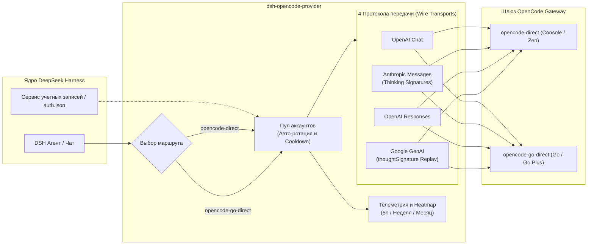

# 📦 @goodandready/dsh-opencode-provider

<div align="center">

<h3>Плагин-провайдер OpenCode Console и OpenCode Go для DeepSeek Harness</h3>

<p>
  <a href="https://goodandready.app/"></a>
  <a href="https://www.npmjs.com/package/@goodandready/dsh-opencode-provider"></a>
  <a href="https://github.com/GooDAnDReaDY/dsh-opencode-provider/blob/main/LICENSE"></a>
</p>

</div>

<table align="center">
  <tr>
    <td align="center">
      ⭐ <strong>Если вам нравится этот плагин, поставьте ему Star на GitHub</strong> — это покажет мне, что плагин полезен, и добавит мотивации продолжать его развитие.
      <br><br>
      🐛 <strong>Если вы нашли баг или хотите предложить новую функцию</strong>, создайте Issue на GitHub на любом языке — я рассмотрю предложение и реализую полезные улучшения в одной из следующих версий плагина.
    </td>
  </tr>
</table>

---

Плагин-провайдер OpenCode / OpenCode Go для [DeepSeek Harness](https://deepseek-harness.github.io/deepseek-harness/) (dsh).

Плагин регистрирует два нативных LLM-маршрута:

| Маршрут | Продукт / Тариф | Базовый эндпоинт | Назначение |
|---|---|---|---|
| `opencode-direct` | OpenCode Console / Zen | `https://opencode.ai/inference` | Поминутная тарификация (pay-as-you-go) |
| `opencode-go-direct` | OpenCode Go / Go Plus | `https://opencode.ai/inference/go` | Фиксированная подписка с лимитами 5h / недели / месяца |

Ключи разрешаются динамически на каждый вызов: смена токена в настройках или в файле окружения вступает в силу мгновенно без перезапуска сервера.

Суффикс `-direct` нужен потому, что встроенный каталог `llm-pi-ai` уже объявляет
`opencode` и `opencode-go`. Повтор этих id даёт `DUPLICATE_DIRECTORY`, из-за чего
ядро отбрасывает встроенный каталог, исчезают остальные провайдеры и отключается
кнопка добавления. Старые сессии с прежними id остаются на встроенных маршрутах;
для возможностей плагина выбирайте **OpenCode (plugin)** или
**OpenCode Go (plugin)**.

## Архитектура



## Полный обзор возможностей

- **Четыре нативных транспорта**, выбираемых автоматически под каждую модель:
  - OpenAI Chat Completions (DeepSeek, GLM, Kimi, MiMo, LongCat, Hy3, Step и др.).
  - Anthropic Messages (Claude, MiniMax, Qwen).
  - OpenAI Responses (GPT, Grok, Muse).
  - Google Generative AI (Gemini).
- **Полноценная поддержка всех типов данных**: текст, рассуждения (reasoning), стриминг вызовов инструментов (tool calls), статистика токенов (usage), корректные finish reasons.
- **Обработка изображений** через встроенный сервис attachments с нативным рендерингом под протокол конкретного транспорта; **файлы** проецируются в детерминированный handle-text DSH (с read-only путём от harness), без inline-байтов.
- **Изображения в tool-result** встраиваются в Anthropic, OpenAI Responses и Google; OpenAI Chat оставляет текстовый placeholder.
- **Воспроизведение метаданных провайдеров** при строгих требованиях API:
  - Подписи рассуждений Anthropic (`thinking signatures`).
  - Google `thoughtSignature` в истории вызовов функций.
- **Пул аккаунтов с интеллектуальной авто-ротацией** до старта генерации:
  - Автоматический переход на следующий аккаунт при 401/403/429 или ответах о превышении квот (400/402/403/429).
  - До 20 аккаунтов с drag-and-drop приоритетом. Недействительный ключ охлаждается 5 минут, превышение квоты — 10 минут (или по заголовку `Retry-After`), rate limit — 60 секунд (или по `Retry-After`). Аккаунт, обслуживший последний запрос, поднимается первым для следующих диалогов и сохраняется после рестарта.
  - Если запрос уже начал стриминг, он не переключается посреди ответа; следующий запрос берёт следующий готовый ключ.
- **Sidebar-карточка квот**: режим **Auto / Always / Off** в разделе **Sidebar**; `Auto` показывает карточку при наличии Go-расхода, `Off` останавливает фоновый polling.
- **Квоты по каждому аккаунту**: отображение индивидуального расхода за 5 часов, неделю и месяц; активный аккаунт управляет сайдбаром и панелью.
- **Runway по каждому аккаунту**: оценка времени до исчерпания по среднему темпу каждого окна; отмечается первое окно, которое закончится раньше сброса. Оценка приблизительная: API отдаёт только текущий процент и время сброса.
- **Онбординг аккаунтов**: **Import all from auth.json** переносит все ключи OpenCode в отдельные credential ref и добавляет аккаунты; **Check all accounts** обновляет квоты и health по каждому аккаунту.
- **Правила «модель ➔ аккаунт»**: сопоставление по glob-паттернам закрепляет предпочтительный аккаунт за моделью; остальные аккаунты остаются в резерве.
- **Per-model overrides**: контекст и лимит вывода настраиваются для каждой модели; `0` убирает лимит вывода.
- **Квотный fallback**: выберите бесплатную модель в настройках; при ошибке квоты Go тот же запрос один раз повторяется через Console/Zen. Если fallback тоже не сработал, возвращается исходная ошибка квоты.
- **Липкий аккаунт**: последний успешный аккаунт предпочитается в том же диалоге и сохраняется между перезапусками в локальном `sticky.json` (только хешированные session id и fingerprint ключей); явные правила модели, закреплённый аккаунт и квотный fallback имеют приоритет.
- **Трассировка маршрутизации**: панель квот показывает последние решения (`rule`, `sticky`, `rotation`, `quota-fallback`) без промптов и ключей.
- **Статистика по аккаунтам**: в request log пишутся `ok`, `latencyMs`, `ttftMs` и `error`; heatmap показывает таблицу запросов, ошибок и средних latency/TTFT по каждому аккаунту.
- **Почасовой Heatmap запросов**: сетка «день недели × час» в локальном времени плюс суточная полоса агрегации. Фильтры переключают отображение между всеми запросами, конкретной моделью и аккаунтом. Лог `~/.dsh/storages/dsh-opencode/requests.jsonl` хранит только метаданные `{at, provider, model, purpose, account, reason, ok, latencyMs, ttftMs, error}` (промпты и ответы не сохраняются).
- **Стабильный заголовок `x-opencode-session`**: вычисляется из устойчивого ID сессии DSH, обеспечивая одинаковый ключ маршрутизации при повторах и диалоге.
- **Живой каталог моделей**: автоматическое чтение `/v1/models` с резервным fallback из `models.dev`.
- **Proxy**: live-параметр `proxyUrl` направляет инференс, каталог и проверку квот через HTTP, HTTPS или SOCKS5; dispatcher переиспользуется до смены адреса. `proxyUsername` и пароль из credential-сервиса включают Basic auth для HTTP и SOCKS5. Пароль не возвращается в браузер.
- **Переключатели маршрутов**: Console/Zen и Go/Go Plus включаются и отключаются независимо; отключённый маршрут исчезает из выбора и отклоняет запросы. Хотя бы один маршрут остаётся включённым.
- **Оценки лимитов подписки OpenCode Go**: долларовый лимит и расчетное число запросов для окон 5h, недели и месяца для планов Go и Go Plus.
- **Команда `/opencode`**: быстрый просмотр статуса, квот, аккаунтов, моделей, правил и запуск теста связи `test [model]`.
- **Настройки в терминале (TUI)**: раздел `/settings → OpenCode` для профиля terminal с ключом, эндпоинтами, allowlist, активным аккаунтом, fallback-моделью, sticky-маршрутизацией и таймаутами.
- **Интеграция с Settings → Models**: стандартные карточки OpenCode/OpenCode Go; ключ задаётся только через «Изменить».
- **One-Click обновление плагина**: кнопка **Update now** в настройках проверяет npm registry, ставит точную версию через DSH CLI и запрашивает перезапуск.
- **Plan-aware Go picker**: фильтрация моделей вне тарифной сетки Go с бейджами `Go`, `Console` или `FREE`.
- **Защита лимита MCP-инструментов**: сохраняет системные инструменты DSH (`read`, `write`, `edit`, `bash`, `glob`, `grep`) при сокращении сторонних инструментов под лимит 128.
- **Панель аналитики использования**: карточки KPI (запросы, токены, успешность, reasoning, кэш, TTFT, задержка), фильтр 7/30/90 дней и таблицы Models / Days / Sessions.

## Установка

Сборка и упаковка из исходников:

```bash
npm install
npm run build
npm pack
```

Установка из **упакованного tarball**:

```bash
dsh plugin --profile web add /absolute/path/to/goodandready-dsh-opencode-provider-0.5.41.tgz
# DSH Desktop:
dsh plugin --profile desktop add /absolute/path/to/goodandready-dsh-opencode-provider-0.5.41.tgz

# Либо установка опубликованного пакета из npm:
dsh plugin --profile web add @goodandready/dsh-opencode-provider@0.5.41
```

После установки перезапустите dsh (или DSH Desktop) и выберите **OpenCode (plugin)** или **OpenCode Go (plugin)** в списке моделей.

## Конфигурация

Пример файла конфигурации:

```yaml
- id: llm-opencode
  name: "@goodandready/dsh-opencode-provider"
  config:
    apiKeyEnv: OPENCODE_API_KEY   # переменная окружения или имя credential
    # apiKey: oc_sk_...           # только для локальной сборки, не коммитить!
    openCodeAuthEntry: opencode-go
    requestTimeoutMs: 300000
    streamIdleTimeoutMs: 300000
    visibleModels: []
    modelTransports: {}
    accounts:
      - label: Go #2
        apiKeyEnv: OPENCODE_API_KEY_2
    activeAccount: ''            # метка аккаунта для принудительного закрепления
```

### Источники ключей

1. `config.apiKey` в конфигурации DSH (`role('secret')`).
2. Системные учетные данные DSH по имени `apiKeyEnv`.
3. Авто-импорт из `~/.local/share/opencode/auth.json` (по ключу `openCodeAuthEntry`, по умолчанию `opencode-go`), записанный CLI-утилитой OpenCode.
4. Переменные окружения процесса, проекта `.env` или `$DSH_HOME/.env`.

### Настройка пула аккаунтов и ротации

Добавьте второй аккаунт в **Настройки → OpenCode → Accounts**: укажите метку (например, `Go #2`) и имя переменной/credential (`OPENCODE_API_KEY_2`), вставьте ключ и сохраните. Аккаунт по умолчанию (`default`) всегда обслуживает запросы первым, если не закреплен другой.

При ошибке авторизации, исчерпании лимита или rate limit адаптер помечает ключ периодом охлаждения (cooldown) и немедленно повторяет запрос со следующим доступным аккаунтом. Состояния cooldown сохраняются между перезапусками в `~/.dsh/storages/dsh-opencode/cooldowns.json` по SHA-256 хешу ключа — сырые токены на диск не записываются.

### Правила привязки «модель ➔ аккаунт»

С помощью glob-паттернов можно закрепить определенные модели за выделенными аккаунтами:

```yaml
modelAccountRules:
  - pattern: "*free*"
    account: "free"
  - pattern: "your-provider-*"
    account: "go"
```

## Страница настроек Web UI

В разделе **Настройки → OpenCode**:
- **Key**: статус ключа, вставка, импорт из OpenCode CLI, очистка и кнопка **Test connection** с замером задержки.
- **Quota**: шкалы расхода за 5 часов, неделю и месяц с датами сброса и предупреждениями при 80% и 95%.
- **Accounts**: управление пулом дополнительных учетных записей.
- **Models**: поиск, обновление каталога, фильтрация allowlist, переопределение транспорта и просмотр стоимости токенов.
- **Connection**: таймауты, базовые URL, прокси, admin token и переключатели маршрутов.
- **Plugin update**: статус версии и кнопка **Update now**.

## Команды CLI

```bash
/opencode status            # статус аккаунтов, квоты и правила
/opencode usage             # текущие окна квот
/opencode accounts          # список меток, статус и расход 5h/wk/mo
/opencode models            # список моделей и лимиты Go
/opencode rules             # правила модель ➔ аккаунт
/opencode test [model]      # проверочный запрос к модели
```

Язык вывода задаётся в **Настройки → OpenCode → `/opencode` command language** (`中文` включает китайский). По умолчанию английский.

### Матрица движков

`npm run test:engine -- <candidate.tgz>` проверяет неизменяемый уже собранный пакет по `engines.dsh` и `dsh.compatibility.dshReleases`, а также состав production-файлов. Команда только читает: не ставит DSH, не запускает runtime, не распаковывает архив, не трогает другие плагины и не требует cleanup. Прогон совместимости выполняется на согласованном тестовом контуре MiniPC с опубликованным кандидатом — не из worktree и без принудительных процессов или рекурсивного удаления.

## Дополнительно в 0.5.22–0.5.36

- **Аутентифицированный прокси**: `proxyUsername` + пароль из credential-сервиса для HTTP/HTTPS/SOCKS5; пароль не возвращается в браузер.
- **Переключатели маршрутов** Console/Zen и Go/Go Plus; отключённый маршрут исчезает из picker и отклоняет запросы.
- **Переопределения по моделям**: контекст, лимит вывода, транспорт; `0` убирает лимит вывода.
- **Аналитика и heatmap**: запросы, токены, TTFT, задержки, модели/дни/сессии и сетка день×час; только локальные числовые метаданные.
- **Режимы квоты** Auto/Always/Off, sticky-маршрутизация, `autoSwitch`, уведомление о смене аккаунта и карточка обновления.
- **Admin token** для LAN/web-профиля; запросы через прокси без токена отклоняются (401 fail-closed).

## Безопасность и надежность

- Same-origin — это защита от CSRF, а не аутентификация. Задайте admin-токен владельца в конфиге профиля (`adminToken`) или `OPENCODE_ADMIN_TOKEN`; тогда все маршруты `/dsh-opencode/*` требуют `x-opencode-token` или `Authorization: Bearer`. UI спросит токен один раз и сохранит его в браузере. Без токена loopback-клиенты работают, а LAN-клиенты получают 401.
- `npm audit` по-прежнему показывает `zod < 4.6.6` (GHSA-mrhx-c7xc-m3w5): пакеты `@deepseek-ai/dsh-*` 0.2.2-rc.1 фиксируют zod 4.4.3. Релиза DSH 0.2.2 с 4.6.6 пока нет; плагин не бандлит zod и не применяет принудительный override. Повторить аудит после обновления DSH.
- Тексты запросов и ответов пользователей никогда не записываются в файлы журнала.
- При исчерпании квоты на одном ключе диалог пользователя не прерывается благодаря бесшовной ротации.

## Лицензия

MIT © [GooDAnDReaDY](https://github.com/GooDAnDReaDY). См. [LICENSE](./LICENSE) и [NOTICE](./NOTICE).

