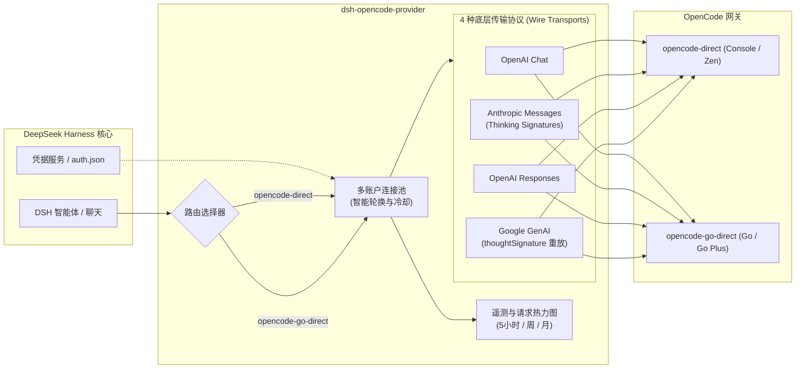

# 📦 @goodandready/dsh-opencode-provider

<div align="center">

<h3>面向 DeepSeek Harness 的 OpenCode Console 与 OpenCode Go 提供商插件</h3>

<p>
  <a href="https://goodandready.app/"></a>
  <a href="https://www.npmjs.com/package/@goodandready/dsh-opencode-provider"></a>
  <a href="https://github.com/GooDAnDReaDY/dsh-opencode-provider/blob/main/LICENSE"></a>
</p>

</div>

<table align="center">
  <tr>
    <td align="center">
      ⭐ <strong>如果您喜欢这个插件，请在 GitHub 上为它点亮 Star</strong> — 这能让我知道插件对您有用，并鼓励我继续开发和维护它。
      <br><br>
      🐛 <strong>如果您发现 Bug 或希望增加功能</strong>，请使用任意语言在 GitHub 上提交 Issue — 我会评估您的建议，并在后续版本中实现有价值的改进。
    </td>
  </tr>
</table>

---

面向 [DeepSeek Harness](https://deepseek-harness.github.io/deepseek-harness/)（dsh）的 OpenCode / OpenCode Go 提供商插件。

插件注册两个原生 LLM 路由：

| 路由 | 产品 / 方案 | 基础接口 | 特性说明 |
|---|---|---|---|
| `opencode-direct` | OpenCode Console / Zen | `https://opencode.ai/inference` | 按量计费（pay-as-you-go） |
| `opencode-go-direct` | OpenCode Go / Go Plus | `https://opencode.ai/inference/go` | 订阅专属，含 5小时/每周/每月配额估算 |

密钥在每次调用时动态解析：在设置中或环境文件中更换凭据无需重启服务器即可立即生效。

`-direct` 后缀用于避免与内置 `llm-pi-ai` 已声明的 `opencode` / `opencode-go` 冲突。
重复 id 会触发 `DUPLICATE_DIRECTORY`，导致核心丢弃内置目录、其他提供商消失并禁用添加按钮。
旧会话继续使用内置路由；要使用本插件的账户、配额、回退和遥测，请选择
**OpenCode (plugin)** 或 **OpenCode Go (plugin)**。

## 架构示意



## 功能全貌

- **4 种原生传输协议**，按模型自动优选：
  - OpenAI Chat Completions（DeepSeek、GLM、Kimi、MiMo、LongCat、Hy3、Step 等）。
  - Anthropic Messages（Claude、MiniMax、Qwen）。
  - OpenAI Responses（GPT、Grok、Muse）。
  - Google Generative AI（Gemini）。
- **完整数据类型流式支持**：文本、思考推理（reasoning）、流式工具调用（tool calls）、用量统计与 finish reasons。
- **多模态图像传输**：通过持久化附件服务，按协议原生转换与传输；**文件**转为 DSH 确定性 handle 文本（由 harness 提供只读路径），不传 inline 字节。
- **工具结果中的图像**在 Anthropic、OpenAI Responses 和 Google 中内联；OpenAI Chat 因消息格式限制保留文本占位符。
- **账户引导**：**Import all from auth.json** 将所有 OpenCode 密钥导入独立 credential ref 并添加账户；**Check all accounts** 刷新每个账户的配额与健康状态。
- **协议特定元数据重放**：
  - Anthropic 思考签名（`thinking signatures`）。
  - Google 历史函数调用中的 `thoughtSignature`。
- **多账户智能无缝轮换**：
  - 在生成流开始前，遇到 401/403/429 或配额用尽响应（400/402/403/429）自动重试下一个账户。
  - 无效密钥冷却 24 小时，超额冷却 10 分钟（或遵循 `Retry-After`），速率限制冷却 60 秒。
  - 正在流式传输中的请求不会被打断，下一个请求会自动使用下一个可用密钥。
- **侧边栏配额卡片**：独立 **Sidebar** 开关（TUI 也可设置）；保存后立即显示/隐藏，无需等待 60 秒轮询。
- **多账户额度与健康监控**：每行独立展示 5 小时、每周与每月使用情况，活跃账户驱动侧边栏与配额面板。
- **每账户预计可用时长**：按各窗口的平均消耗速度估算耗尽时间，并标记在重置前最先耗尽的窗口；API 仅提供当前百分比与重置时间，因此为近似值。
- **模型 ➔ 账户路由规则**：支持 Glob 通配符（如 `*free*`、`deepseek-*`）将模型优先绑定至特定账户，其他账户保留为备用。
- **配额回退**：在设置中选择免费模型；Go 返回配额错误时，同一请求通过 Console/Zen 重试一次。若回退也失败，返回原始配额错误。
- **会话粘性账户**：同一会话优先使用上次成功的账户，并通过本地 `sticky.json` 跨重启保留（仅哈希后的 session id 和密钥指纹）；显式模型规则、固定账户和配额回退优先。
- **路由追踪**：配额面板显示最近的账户/模型决策（`rule`、`sticky`、`rotation`、`quota-fallback`），不记录提示词或密钥。
- **按账户请求统计**：请求日志记录 `ok`、`latencyMs`、`ttftMs` 和 `error`；热力图表格显示每个账户的请求数、错误数及平均延迟/TTFT。
- **本地时间请求热力图**：星期×小时交互式热力图，排除系统心跳与重复记录，可按模型或账户过滤，仅保存 `{at, provider, model, purpose, account, reason, ok, latencyMs, ttftMs, error}` 元数据，不保存任何提示词与回复。
- **稳定的 `x-opencode-session` 标头**：根据 DSH 会话 ID 派生，确保重试与连续对话复用相同的网关路由键。
- **实时模型目录**：自动从 `/v1/models` 同步，并以 `models.dev` 生成文件作为回退。
- **Go 订阅额度估算**：每月美元额度以及 5 小时、每周和每月的估算请求次数。
- **`/opencode` 斜杠指令**：快速查询状态、配额、账户、模型及执行联通性测试。
- **TUI 设置**：`/settings → OpenCode` 支持密钥、端点、allowlist、活动账户、回退模型、粘性路由和超时。
- **Web UI 一键更新**：设置页集成版本比对与一键热更新按钮。
- **MCP 工具上限防护**：在大规模 MCP 工具集达到 128 工具限制时，优先保留 DSH 核心系统工具。

## 安装指南

从源码构建与打包：

```bash
npm install
npm run build
npm pack
```

通过**打包文件 (.tgz)**安装：

```bash
dsh plugin --profile web add /absolute/path/to/goodandready-dsh-opencode-provider-0.5.13.tgz
# DSH 桌面端：
dsh plugin --profile desktop add /absolute/path/to/goodandready-dsh-opencode-provider-0.5.13.tgz

# 或从 npm 安装已发布版本：
dsh plugin --profile web add @goodandready/dsh-opencode-provider@0.5.13
```

安装完成后重启 dsh 或 DSH 桌面端，在模型选择器中选择 **OpenCode (plugin)** 或 **OpenCode Go (plugin)** 即可。

## 配置示例

```yaml
- id: llm-opencode
  name: "@goodandready/dsh-opencode-provider"
  config:
    apiKeyEnv: OPENCODE_API_KEY   # 环境变量或 DSH 凭据名
    # apiKey: oc_sk_...           # 仅本地调试，严禁提交代码库
    openCodeAuthEntry: opencode-go
    requestTimeoutMs: 300000
    streamIdleTimeoutMs: 300000
    visibleModels: []
    modelTransports: {}
    accounts:
      - label: Go #2
        apiKeyEnv: OPENCODE_API_KEY_2
    activeAccount: ''            # 固定指定活跃账户名称
```

### 密钥解析顺序

1. DSH 配置中的 `config.apiKey`。
2. DSH 凭据服务中由 `apiKeyEnv` 指定的凭据。
3. `~/.local/share/opencode/auth.json` 中的 `openCodeAuthEntry` 项（默认 `opencode-go`）。
4. 进程环境变量或 `$DSH_HOME/.env`。

### 模型到账户路由规则

```yaml
modelAccountRules:
  - pattern: "*free*"
    account: "free"
  - pattern: "your-provider-*"
    account: "go"
```

## 常用指令

```bash
/opencode status            # 查看账户健康状态、配额与路由规则
/opencode usage             # 查看当前配额窗口
/opencode accounts          # 账户列表与 5h/周/月消耗
/opencode models            # 模型列表与 Go 方案限制
/opencode rules             # 模型到账户规则
/opencode test [model]      # 发送最小化测试请求
```

## 安全规范

- 写入与配置路由均要求 Loopback（`127.0.0.1` / `::1`）与同源检查，防御 DNS 重新绑定。
- 密钥冷却状态通过 SHA-256 哈希指纹持久化，本地日志不保存提示词与明文密钥。

## 许可证

MIT © [GooDAnDReaDY](https://github.com/GooDAnDReaDY)。详见 [LICENSE](./LICENSE) 与 [NOTICE](./NOTICE)。

